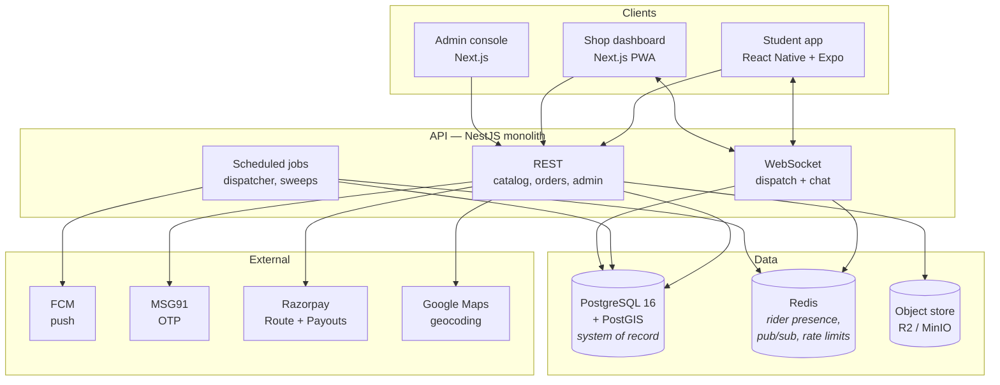

# Architecture

## Shape

One server, several clients, two data stores. Deliberately boring: the
interesting problems here are concurrency and tenancy, not distributed
systems, and a monolith makes both easier to reason about.

## Why these choices

**NestJS monolith, not microservices.** The whole system is one bounded
context — a delivery on a campus. Splitting it would mean distributed
transactions across the order, the task and the ledger, which `NFR-R-03`
("ledger entries written in the same transaction as the completion that causes
them") makes effectively impossible. One database, one transaction boundary.

**React Native, not Flutter.** Flutter has the better rendering layer. React
Native wins here because the dashboard and admin console are React anyway, so
validation, types and the API client are shared through `packages/shared` — and
Expo's over-the-air updates mean a dispatch bugfix ships in an hour rather than
waiting on Play Store review. When the core loop is real-time dispatch, that
matters more than animation smoothness.

**Chat is built, not rented.** Stream and Sendbird charge per monthly active
user, which is ruinous for a free student product on thin delivery margins.
More importantly, the messaging layer is a reason students open the app at
all — and a retention hook is core, not a vendor dependency. Text and images
in rooms is a well-understood schema.

**Redis for presence, Postgres for truth.** A rider pings every fifteen
seconds. Writing that to Postgres would mean a write per rider per ping,
sustained, which is the wrong shape of load for a relational database. Online
riders live in a Redis GEO set per college and `GEOSEARCH` answers the
broadcast query in sub-millisecond time. If Redis is wiped, riders re-report on
their next ping; nothing of record is lost.

## Tenancy

Constraint `C-1`: no query may return another college's rows.

Three layers, because one is not enough:

1. **Schema.** Every college-scoped table carries `college_id`.
2. **Database.** A check constraint requires `college_id` on every user except
   a super administrator.
3. **API.** A guard reads `collegeId` from the authenticated token and scopes
   every query. The client is never trusted to supply it — `NFR-S-05`. A
   request whose target resource belongs to a different college returns 403,
   not 404, per `FR-TEN-03`.

The guard is the layer that does the real work, and it is the layer most
likely to be bypassed by a new endpoint that forgets it. Phase 1B adds it as a
global default rather than something each controller opts into, so forgetting
is a compile-time or startup problem rather than a silent data leak.

## The dispatch path

The core loop, in order:

1. A student places an order. An `order` row and a `task` row are created in
   one transaction; the task is `CREATED` with `dispatch_due_at` set to
   `now() + statedPrepMinutes - dispatchLeadMinutes`.
2. The shop accepts and may revise the preparation time, which recomputes
   `dispatch_due_at`.
3. The **dispatcher job** finds tasks whose `dispatch_due_at` has passed, using
   a partial index. For each, it takes a short Redis lock, selects eligible
   riders by `GEOSEARCH` within the configured proximity, and emits the offer
   over WebSocket to each. A `broadcast_log` row records the round, radius, fee
   and how many riders were eligible.
4. Riders see a full-screen offer with a countdown. The first to accept wins,
   decided by **one conditional UPDATE** (`ADR-001`). Everyone else gets
   "already taken" and the offer is withdrawn from their device.
5. The **expiry sweep** finds `BROADCASTING` tasks past `offer_expires_at`. If
   rounds remain, it re-broadcasts with a wider radius and a higher offer; if
   not, the task becomes `UNFULFILLED` and the requester is given the three
   `FR-DLV-07` choices.
6. On assignment, a task chat room opens with the requester, the rider, and
   the shop for shop orders.
7. The shop marks `READY`, which unlocks the rider's pickup button. The rider
   taps it; both rows get `picked_up_at` in one transaction (`ADR-003`).
8. A six-digit handover code is generated, hashed with Argon2id, and shown to
   the requester only. The rider enters it at the drop point. Five wrong
   attempts escalates the task to an administrator.
9. On a valid code, the task goes `DELIVERED` then `COMPLETED`, and the wallet
   entry is written **in the same transaction** (`NFR-R-03`).

## Data stores

### PostgreSQL

The system of record. 38 tables. Two extensions:

- **PostGIS** — one job only: the geodesic distance that decides whether a
  shop may register (`C-2`). Exposed as `hoppo_geodesic_distance_m()`.
- **pg_trgm** — trigram indexes for catalog and community search, so
  `LIKE '%paneer%'` uses an index instead of reading every row.

Integrity lives in the database wherever a rule must never be broken:

- 14 check constraints — tenancy, money arithmetic, coordinate ranges, rating
  bounds, task shape by type, rider presence matching status, government ID
  field length.
- 3 append-only triggers — audit log, wallet ledger, broadcast log
  (`ADR-007`).
- 5 partial indexes — the dispatcher's hot paths and the admin queues.

The reasoning is simple: application code is one bug away from breaking an
invariant, and a constraint is not.

### Redis

| Key | Purpose |
|---|---|
| `riders:geo:<collegeId>` | GEO set of online riders; `GEOSEARCH` at broadcast |
| `riders:ping:<collegeId>` | Last ping per rider, for the idle sweep |
| `riders:busy:<collegeId>` | Riders holding a task, excluded from broadcasts |
| `dispatch:<collegeId>` | Pub/sub so multiple API instances fan out one broadcast |
| `lock:dispatch:<taskId>` | Short lock so two ticks cannot process one task |

Key layouts live in `packages/shared/src/constants.ts` so the dispatcher and
the gateway cannot drift apart on a string.

### Object store

Two buckets. The **public** one holds catalog images and avatars. The
**private** one holds identity documents and shop licences, encrypted at rest
on top of bucket encryption, reachable only through an authenticated
administrator endpoint with every access logged (`C-3`, `NFR-S-03`).

## Security posture

| Requirement | Implementation |
|---|---|
| `NFR-S-01` TLS 1.2+ | Terminated at the platform edge |
| `NFR-S-02` memory-hard hashing | Argon2id with per-user salt |
| `NFR-S-03` documents encrypted, access logged | Private bucket, admin-only endpoint, audit row per access |
| `NFR-S-04` OTPs hashed, expiring, single-use | Argon2id hash, `expires_at`, `consumed_at`, attempt counter |
| `NFR-S-05` server-side authorisation | Global tenant + role guards; client never scopes data |
| `NFR-S-06` rate limiting | Throttler on auth, OTP issue, task accept |
| `NFR-S-07` input validation | `class-validator` DTOs on every endpoint |
| `FR-AUTH-05` session revocation | Refresh tokens are rows, revocable individually or by family |
| `FR-AUTH-06` lockout | `failed_login_count` + `locked_until` |

## Performance targets

From §10.1, and what makes each achievable:

| Target | Approach |
|---|---|
| Catalog browse < 2 s p95 | Composite index on `(college_id, status, distance)`, trigram index for search |
| Broadcast reaches devices < 3 s | WebSocket already connected; Redis `GEOSEARCH` is sub-millisecond |
| Acceptance acknowledged < 1 s | One conditional UPDATE, no lock acquisition |
| Offer withdrawn < 2 s | Redis pub/sub fan-out to all instances |
| 500 concurrent users per tenant | Single instance handles this comfortably; the Redis adapter makes horizontal scaling available when it does not |

## Deployment

Fly.io or Railway in `bom` (Mumbai) — close to the users, and boring to
operate. Managed Postgres with PostGIS, managed Redis, Cloudflare R2 for
objects. GitHub Actions for CI, EAS Build for the mobile app.

Kubernetes is a later problem, not a launch problem.
